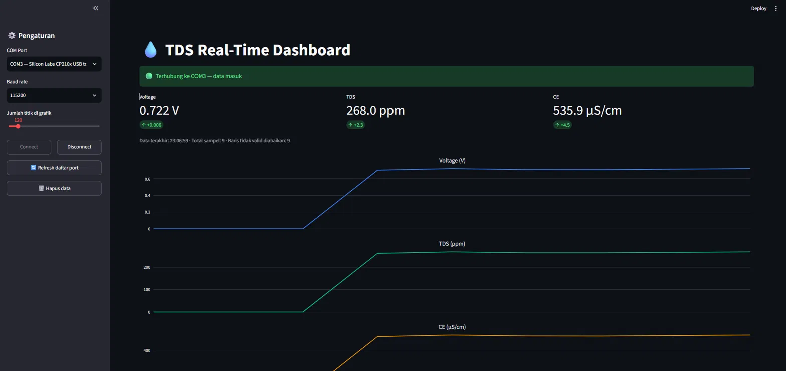

# ESP32-TDS-Sensor
An IoT project involving ESP32 to detect mineral contents in water.

IMPORTANT NOTE

1. The Arduino code file and the Python file must be placed in the same folder named "tds_serial".

2. In PowerShell, navigate to the folder containing the Python file and run the command: "python -m streamlit run dashboard.py"

PREVIEW IMAGE

